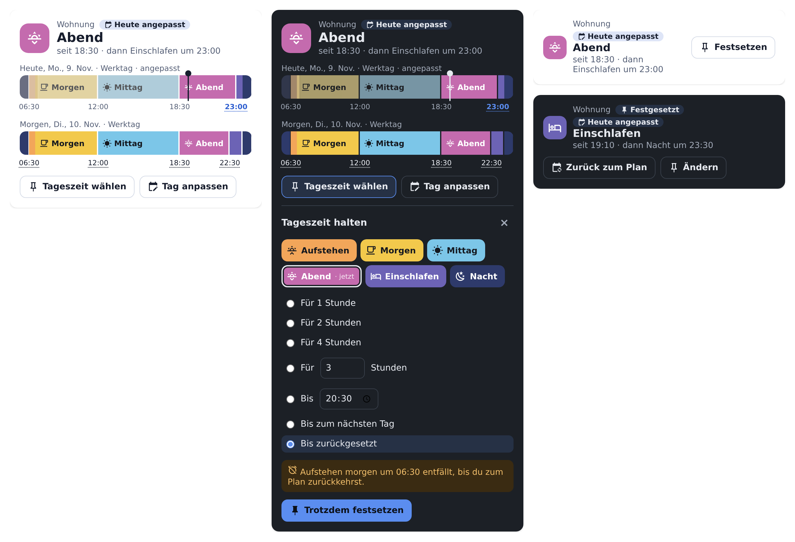
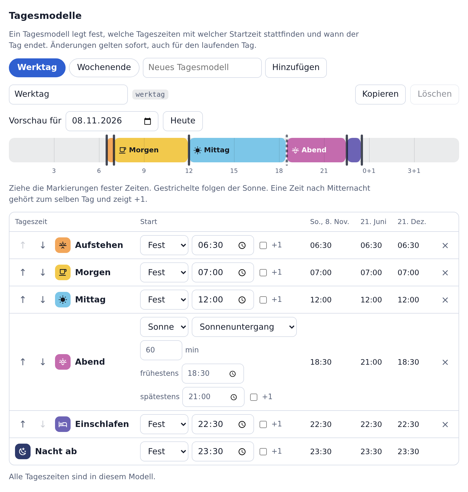

# Cloudless Maestro

Eine Home-Assistant-Integration, die festlegt, welche Tageszeit gerade gilt. Statt vieler zeitgesteuerter Automationen gibt es einen Tagesplan: frei benannte Tageszeiten, Tagesmodelle wie Werktag oder Wochenende, einen Wochenplan und Ausnahmen für einzelne Tage. Ändert sich dein Rhythmus, änderst du nur den Plan.

[English version](README.md)





> **Beta.** Diese Version enthält den ersten Teil von Maestro, die Tageszeiten. Licht-Regeln mit Bewegungsmeldern, Gedächtnis für manuelle Einstellungen und Verläufe wie ein Lichtwecker folgen in den nächsten Versionen.

## Was du bekommst

- **Rhythmen.** Ein Rhythmus ist ein eigener Tagesplan, zum Beispiel für die Wohnung, ein Terrarium oder ein Kinderzimmer. Mehrere Rhythmen laufen unabhängig nebeneinander.
- **Eigene Tageszeiten.** Jede Tageszeit hat Name, Symbol und Farbe. Ihr Schlüssel bleibt beim Umbenennen gleich, damit Automationen weiterlaufen.
- **Tagesmodelle.** Startzeiten fest oder nach Sonnenstand, mit Versatz und den Grenzen *frühestens* und *spätestens*. Zeiten dürfen nach Mitternacht liegen, etwa bei einer Party bis 06:00.
- **Wochenplan und Kalender.** Jeder Wochentag bekommt ein Modell. Ein Kalender aus Home Assistant kann einzelne Daten übersteuern, zum Beispiel an Feiertagen, bei Wechselschicht oder im Urlaub.
- **Festsetzen.** Jetzt eine Tageszeit setzen, vorher oder später im Tag, bis zum nächsten Wechsel, für eine Dauer, bis zu einer Uhrzeit, bis zum nächsten Tag oder bis du zurücksetzt. Dauer und Uhrzeit enden spätestens, wenn der nächste Tag beginnt, damit dein Wecker nie unbemerkt ausfällt.
- **Tag anpassen.** Für ein einzelnes Datum ein anderes Modell oder andere Zeiten, auch im Voraus: „heute Einschlafen erst 23:30“.
- **Für Automationen.** Jeder Rhythmus ist ein Gerät mit Sensoren, Triggern, Bedingungen, Aktionen und einem Ereignis bei jedem Wechsel.
- **Eine Karte und eine Einstellungsseite**, ohne YAML. Deutsch und Englisch.

## Installieren

**Home Assistant 2026.11 oder neuer (Marketplace)**

[](https://my.home-assistant.io/redirect/hacs_repository/?owner=MadisonMedia&repository=cloudless-maestro&category=integration)

1. Wähle den Button oben, oder gehe zu **Einstellungen → Marketplace** und füge `https://github.com/MadisonMedia/cloudless-maestro` per Link hinzu. Dafür braucht es eine Verbindung zu GitHub, nach der der Marketplace fragt.
2. Solange Maestro im Beta-Stadium ist, schalte beim Repository den Schalter für Vorabversionen (Pre-release) ein und installiere es dann.

**Home Assistant 2026.10 oder älter (HACS)**

1. Öffne in HACS das Menü oben rechts und wähle **Benutzerdefinierte Repositories**.
2. Füge `https://github.com/MadisonMedia/cloudless-maestro` mit dem Typ **Integration** hinzu.
3. Installiere **Cloudless Maestro** und starte Home Assistant neu.

Benötigt Home Assistant 2026.2 oder neuer.

## Den ersten Rhythmus anlegen

[](https://my.home-assistant.io/redirect/config_flow_start/?domain=cloudless_maestro)

Gehe zu **Einstellungen → Geräte & Dienste → Integration hinzufügen → Cloudless Maestro**, gib einen Namen ein und wähle, womit du beginnst: einem typischen Tag mit Aufstehen, Morgen, Mittag, Nachmittag, Abend und Einschlafen, oder einer einzelnen Tageszeit zum Selbstaufbauen. Danach erscheint **Maestro** in der Seitenleiste. Dort stellst du alles ein und legst weitere Rhythmen an.

## So wird gerechnet

- Ein Tag gilt vom Start seiner ersten Tageszeit bis zu seinem Tagesende. Dazwischen gilt der **Grundzustand**, zum Beispiel „Nacht“. Einen festen Tageswechsel um Mitternacht gibt es nicht.
- Jede Tageszeit gilt bis zum Start der nächsten. Beginnt der Folgetag, bevor der Vortag endet, gewinnt der Folgetag.
- Liegt eine berechnete Startzeit vor der vorherigen oder nach dem Tagesende, fällt diese Tageszeit an dem Tag aus. Die Einstellungsseite zeigt das in der Vorschau.
- Sonnenzeiten gelten für den Standort von Home Assistant oder einen eigenen Standort pro Rhythmus. Gibt es ein Ereignis an einem Tag nicht, etwa im Polartag, gilt die gesetzte Grenze.
- Alle Zeiten sind lokale Uhrzeit. Eine Uhrzeit, die es bei der Umstellung im März nicht gibt, wird zur nächsten gültigen Minute. Eine doppelte Uhrzeit im Oktober gilt beim ersten Mal.
- **Heute** ist der Tag, der gerade läuft. Im Grundzustand ist es der kommende Tag. Um 05:00 vor dem Aufstehen kannst du also schon „Aufstehen“ festsetzen.

## Festsetzen und Tag anpassen

| Ende | Bedeutung |
| --- | --- |
| Bis zum nächsten Wechsel | Bis der Plan eine Tageszeit beginnt, die im Modell nach der gewählten liegt, oder der Tag endet |
| Für eine Dauer | 1, 2 oder 4 Stunden oder frei, höchstens bis der nächste Tag beginnt |
| Bis Uhrzeit | Höchstens bis der nächste Tag beginnt |
| Bis zum nächsten Tag | Bis die erste Tageszeit des nächsten Tages beginnt |
| Bis zurückgesetzt | Ohne Ende. Die Karte zeigt vorher, welcher Wechsel ausfällt. |

Eine neue Festsetzung ersetzt die vorige. **Zurück zum Plan** hebt sie auf. Eine Tagesanpassung speichert nur das Abweichende: Änderst du später das Tagesmodell, gilt das an diesem Tag für alle anderen Zeiten. Festsetzungen und Tagesanpassungen überstehen einen Neustart. Hat sich die Tageszeit während eines Neustarts geändert, gibt es genau einen Wechsel.

## In Automationen

Jeder Rhythmus ist ein Gerät mit diesen Entitäten:

| Entität | Zustand |
| --- | --- |
| Tageszeit | Schlüssel der aktuellen Tageszeit, mit Name, Farbe, seit, bis und nächster Tageszeit als Attribute |
| Tageszeit wählen | Eine Auswahl setzt die Tageszeit bis zum nächsten Wechsel fest |
| Tagesmodell | Schlüssel des heutigen Modells und woher es kommt |
| Nächster Wechsel | Zeitpunkt des nächsten Wechsels |
| Fortschritt | Wie weit die aktuelle Tageszeit vergangen ist, in Prozent |
| Übersteuert | An bei einer Festsetzung oder einer Tagesanpassung für heute |

Im Automationseditor bietet das Gerät die Trigger **Eine Tageszeit beginnt**, **Eine Tageszeit endet** und **Die Tageszeit wechselt** sowie die Bedingungen **Die Tageszeit ist eine von** und **Der Plan ist übersteuert**. Bei jedem Wechsel feuert außerdem das Ereignis `cloudless_maestro_changed` mit `from`, `to` und dem Grund.

| Aktion | Zweck |
| --- | --- |
| `cloudless_maestro.pin` | Eine Tageszeit festsetzen, mit Ende |
| `cloudless_maestro.resume` | Zurück zum Plan |
| `cloudless_maestro.adjust_day` | Ein Datum anpassen: anderes Modell, andere Startzeiten, anderes Tagesende |
| `cloudless_maestro.clear_day` | Eine Tagesanpassung entfernen |
| `cloudless_maestro.refresh_calendars` | Die verknüpften Kalender sofort neu lesen |

```yaml
# Heute später ins Bett
action: cloudless_maestro.adjust_day
target:
  entity_id: sensor.wohnung_tageszeit
data:
  times:
    einschlafen: "23:30"
  end: "00:30+1"
```

## Die Karte

Bearbeite ein Dashboard, füge eine Karte hinzu und wähle **Maestro**. Die volle Variante zeigt die aktuelle Tageszeit, den Tag als Zeitleiste und auf Wunsch auch morgen. Tippe auf eine kommende Uhrzeit, um diesen Wechsel nur an diesem Datum zu verschieben. Die kompakte Variante zeigt nur Tageszeit und Festsetzen.

## Entwicklung

```bash
pip install -r requirements_test.txt
pytest -q
ruff check .
```

`tests/frontend/harness.html` führt die echte Karte und Einstellungsseite gegen ein simuliertes Home Assistant aus, mit Daten aus dem echten Backend. Liefere das Hauptverzeichnis des Repositorys mit einem beliebigen lokalen Webserver aus und öffne diese Datei. Mit `MAESTRO_WRITE_HARNESS=1 pytest tests/test_harness_data.py` erneuerst du die Daten.

## Lizenz

MIT
