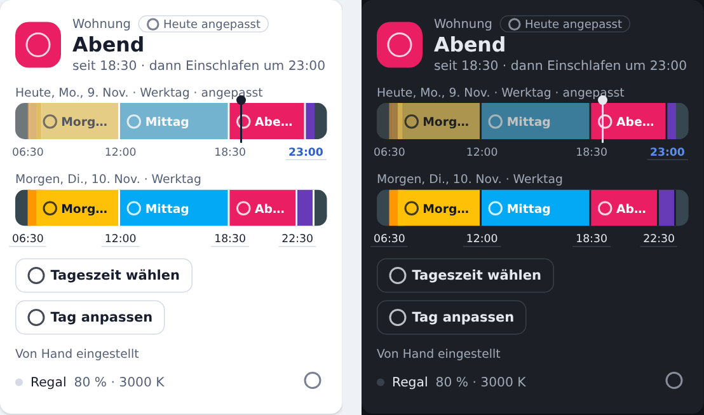
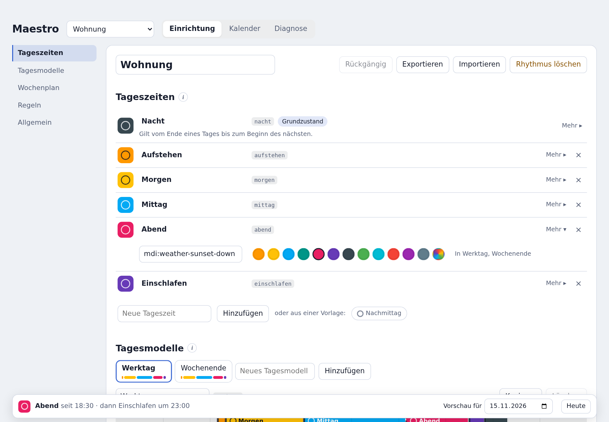
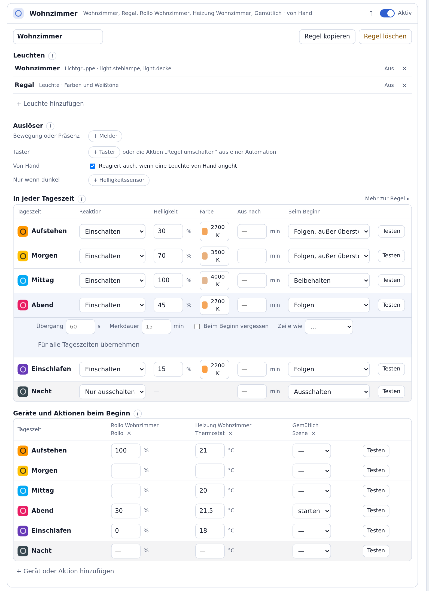

# Cloudless Maestro

Eine Home-Assistant-Integration, die festlegt, welche Tageszeit gerade gilt, und was deine Leuchten darin tun. Statt vieler zeitgesteuerter Automationen gibt es einen Tagesplan: frei benannte Tageszeiten, Tagesmodelle wie Werktag oder Wochenende, einen Wochenplan und Ausnahmen für einzelne Tage. Regeln legen pro Tageszeit fest, wie Bewegungsmelder, Taster und der Schalter an der Wand reagieren. Ändert sich dein Rhythmus, änderst du nur den Plan.

[English version](README.md)







> **Beta.** Tageszeiten, Regeln und der Lichtwecker sind drin. Rückmeldungen aus dem Betrieb fließen in die nächsten Versionen.

## Was du bekommst

- **Rhythmen.** Ein Rhythmus ist ein eigener Tagesplan, zum Beispiel für die Wohnung, ein Terrarium oder ein Kinderzimmer. Mehrere Rhythmen laufen unabhängig nebeneinander.
- **Eigene Tageszeiten.** Jede Tageszeit hat Name, Symbol und Farbe. Ihr Schlüssel bleibt beim Umbenennen gleich, damit Automationen weiterlaufen.
- **Tagesmodelle.** Startzeiten fest oder nach Sonnenstand, mit Versatz und den Grenzen *frühestens* und *spätestens*. Zeiten dürfen nach Mitternacht liegen, etwa bei einer Party bis 06:00.
- **Wochenplan und Kalender.** Jeder Wochentag bekommt ein Modell. Ein Kalender aus Home Assistant kann einzelne Daten übersteuern, zum Beispiel an Feiertagen, bei Wechselschicht oder im Urlaub.
- **Regeln.** Leuchten mit Auslösern und einer Zeile pro Tageszeit: wie hell, welche Farbe, wann wieder aus, und was mit eingeschalteten Leuchten passiert, wenn eine Tageszeit beginnt. Bewegungs- oder Präsenzmelder, Taster und Einschalten von Hand. Ein Helligkeitssensor kann das Einschalten auf dunkle Stunden begrenzen.
- **Gedächtnis.** Ändert jemand eine Leuchte von Hand, merkt sich Maestro das: Innerhalb der Merkdauer geht sie wieder so an, danach wieder mit der Zeile.
- **Lichtwecker.** Eine Leuchte, Lichtgruppe oder ein Crescendo-Objekt dimmt über eine ganze Tageszeit hoch, etwa 30 Minuten lang während „Aufstehen“.
- **Geräte zur richtigen Zeit.** Bei, vor oder nach Beginn oder Ende einer Tageszeit bekommt ein Rollo seine Position, ein Thermostat seine Temperatur, ein Lautsprecher seine Lautstärke; eine Szene oder ein Skript startet. Zum Beispiel die Heizung im Bad 60 Minuten vor dem Aufstehen.
- **Festsetzen und anpassen.** Jetzt eine Tageszeit setzen bis zu einem gewählten Ende, oder einem einzelnen Datum andere Zeiten geben, auch im Voraus.
- **Für Automationen.** Jeder Rhythmus ist ein Gerät mit Sensoren, einem Schalter pro Regel, Triggern mit Versatz, Bedingungen, Aktionen und einem Ereignis bei jedem Wechsel.
- **Eine Karte und eine Einstellungsseite**, ohne YAML. Deutsch und Englisch. Mit [Cloudless Crescendo](https://github.com/MadisonMedia/cloudless-crescendo) steuert Maestro Crescendo-Objekte über deren eigene Aktionen.

## Installieren

**Home Assistant 2026.11 oder neuer (Marketplace)**

[](https://my.home-assistant.io/redirect/hacs_repository/?owner=MadisonMedia&repository=cloudless-maestro&category=integration)

1. Wähle den Button oben, oder gehe zu **Einstellungen → Marketplace** und füge `https://github.com/MadisonMedia/cloudless-maestro` per Link hinzu. Dafür braucht es eine Verbindung zu GitHub, nach der der Marketplace fragt.
2. Solange Maestro im Beta-Stadium ist, schalte beim Repository den Schalter für Vorabversionen (Pre-release) ein und installiere es dann.

**Home Assistant 2026.10 oder älter (HACS)**

1. Öffne in HACS das Menü oben rechts und wähle **Benutzerdefinierte Repositories**.
2. Füge `https://github.com/MadisonMedia/cloudless-maestro` mit dem Typ **Integration** hinzu.
3. Installiere **Cloudless Maestro** und starte Home Assistant neu.

Benötigt Home Assistant 2026.2 oder neuer.

## Den ersten Rhythmus anlegen

[](https://my.home-assistant.io/redirect/config_flow_start/?domain=cloudless_maestro)

Gehe zu **Einstellungen → Geräte & Dienste → Integration hinzufügen → Cloudless Maestro**, gib einen Namen ein, wähle, womit du beginnst (ein typischer Tag oder eine einzelne Tageszeit zum Selbstaufbauen), und welche Farben dir gefallen: die von Home Assistant oder Erdtöne. Danach erscheint **Maestro** in der Seitenleiste.

## Die Einstellungsseite

Wähle den Rhythmus im Kopf, oder **Neuer Rhythmus …**. Die Sprungleiste links führt zu den Abschnitten; Erklärungen stehen hinter dem kleinen **i** neben einer Überschrift.

1. **Tageszeiten:** Name, Schlüssel und unter **Mehr** Symbol und Farbe. Neue legst du mit einem Namen oder aus einer Vorlage an. Eine neue Tageszeit übernimmt in den Regeln die Werte der vorherigen.
2. **Tagesmodelle:** Ziehe die Markierungen in der Zeitleiste oder tippe die Zeiten ein. **Sonne** folgt Sonnenaufgang, Sonnenuntergang oder Dämmerung mit Versatz, **Grenzen** setzt frühestens und spätestens. Die Tabelle zeigt das Ergebnis für das Vorschau-Datum, Hochsommer und Hochwinter. Das Vorschau-Datum steht in der Leiste unten.
3. **Wochenplan:** ein Modell pro Wochentag, mit einem kleinen Streifen, der den Tag zeigt. Darunter die Kalender.
4. **Regeln:** siehe nächster Abschnitt.
5. **Allgemein:** Standort, die Standardwerte der Regeln, Beispiele für Automationen und der Eintrag in der Seitenleiste.

**Rückgängig** nimmt die letzte Änderung zurück. **Exportieren** speichert den Rhythmus als Datei; **Importieren** legt daraus einen neuen Rhythmus an oder ersetzt den gewählten.

## Regeln

Eine Regel hat **Leuchten** (Crescendo-Objekte, einzelne Leuchten und Lichtgruppen), **Auslöser** und eine Zeile pro Tageszeit. Leuchten, Auslöser und Geräte findest du über eine Suche mit Arten als Chips und einer Auswahl des Raums; Crescendo-Objekte stehen vorne.

| Auslöser | Was passiert |
| --- | --- |
| Bewegung oder Präsenz | Schaltet mit der Zeile ein. Erkennt kein Melder der Regel mehr jemanden, läuft die Nachlaufzeit; jede neue Erkennung startet sie neu. Danach dimmt das Licht kurz auf die Hälfte als Vorwarnung und geht aus. Bewegung während der Vorwarnung holt es zurück. |
| Kontakt | Ein anderer Binärsensor, etwa eine Tür, zählt wie ein Bewegungsmelder: offen ist wie Bewegung. |
| Taster | Eine Ereignis-Entität, etwa eine Wandfernbedienung, mit der Art des Drucks. Schaltet um: aus, wenn eine Leuchte an ist, sonst an mit der Zeile. Ohne Bewegungsmelder zählt die Zeit der Zeile ab dem Drücken. |
| Von Hand | Eine Leuchte, die ohne Maestro angeht, bekommt die Werte der Tageszeit oder ihre gemerkten Werte. Geht sie *mit* einem Wert an, etwa „Licht auf 80 %“, behält sie ihn. |
| Nur wenn dunkel | Ein Helligkeitssensor mit Schwelle. Er begrenzt das Einschalten, schaltet aber nie aus. |

Jede **Zeile** hat eine Reaktion (einschalten, Verlauf bis Ende, nur ausschalten, nicht reagieren), Helligkeit, Farbe, die **Nachlaufzeit** und das Verhalten **beim Beginn** der Tageszeit für eingeschaltete Leuchten: der neuen Zeile folgen, folgen außer übersteuert, beibehalten oder ausschalten. Unter **Mehr**: Übergang, Merkdauer, Vergessen beim Beginn, eine Schwelle für diese Zeile, das Übernehmen einer anderen Zeile und das Übernehmen für alle Tageszeiten. **Testen** wendet eine Zeile sofort an.

**Gedächtnis.** Ändert jemand eine Leuchte von Hand, ist sie übersteuert: Sie behält ihre Werte und bekommt sie wieder, wenn sie innerhalb der Merkdauer erneut eingeschaltet wird. Danach gilt wieder die Zeile. „Folgen“ beim Beginn einer Tageszeit beendet eine Übersteuerung; „Folgen, außer übersteuert“ lässt solche Leuchten in Ruhe. Karte und Diagnose zeigen die von Hand eingestellten Leuchten mit **Vergessen**.

**Leuchten in mehreren Regeln.** Der neueste Befehl gewinnt. Eine Leuchte, die eine andere Regel eingeschaltet hat, zählt für eine Bewegungsregel wie von Hand eingeschaltet; unter **Mehr zur Regel** steht, ob solche Leuchten nach derselben Zeit, nach einer eigenen Zeit oder gar nicht ausgehen. Eine von Hand ausgeschaltete Leuchte bleibt aus; Bewegung wird für die Sperrzeit ignoriert, damit sie beim Hinausgehen nicht gleich wieder angeht.

**Lichtwecker: Verlauf bis Ende.** Steht die Reaktion einer Zeile auf „Verlauf bis Ende“, gehen die Leuchten der Regel beim Beginn dieser Tageszeit mit der Helligkeit **von** an und dimmen bis zu ihrem Ende auf **bis**; ohne Wert dort auf die Helligkeit der nächsten Tageszeit. Weißtöne laufen mit. Jede Leuchte bekommt dafür einen Befehl mit Ziel und Dauer und blendet selbst über; Crescendo-Objekte führen den Verlauf mit ihren Stufen und Geräten selbst aus. Verläufe über 1 Stunde 40 Minuten teilt Maestro in Teile, Leuchten ohne eigene Überblendung bekommen kleine Schritte. Während eines Verlaufs schaltet Bewegung nicht aus. Ändert jemand die Leuchte von Hand, endet der Verlauf; **Fortsetzen** in der Karte oder die Aktion `cloudless_maestro.resume_fade` bringt die Leuchte auf den Wert, den sie jetzt hätte, und lässt sie bis zum Ende weiterlaufen. Wird die laufende Tageszeit festgesetzt, hält der Verlauf an und läuft danach weiter. Verschiebt sich das Ende, folgt er. Nach einem Neustart läuft er an der berechneten Stelle weiter.

**Geräte und Aktionen.** Pro Regel bekommen Geräte einmal ihren Wert, zu einem Zeitpunkt deiner Wahl: bei, vor oder nach Beginn oder Ende einer Tageszeit, mit einem Versatz in Minuten. Rollos, Thermostate, Lautsprecher, Lüfter, Schalter, Zahlen sowie Szenen oder Skripte. Eine Aktion am Ende einer Tageszeit gehört zu ihr, egal welche Tageszeit danach kommt. Die Diagnose zeigt die nächsten geplanten Aktionen.

**Crescendo-Objekte** bekommen eine Position von 1 bis 100; die Buttons des Objekts dienen als Vorgaben, und ein leerer Übergang heißt Tempo des Objekts. Maestro hält die Einschaltposition des Objekts aktuell, damit es nie mit einem alten Wert aufblitzt.

Jede Regel hat einen **Schalter** in Home Assistant. Aus heißt pausiert: Die Regel schaltet nichts und folgt keinem Wechsel.

## So wird gerechnet

- Ein Tag gilt vom Start seiner ersten Tageszeit bis zu seinem Tagesende. Dazwischen gilt der **Grundzustand**, zum Beispiel „Nacht“. Einen festen Tageswechsel um Mitternacht gibt es nicht.
- Jede Tageszeit gilt bis zum Start der nächsten. Beginnt der Folgetag, bevor der Vortag endet, gewinnt der Folgetag.
- Liegt eine berechnete Startzeit vor der vorherigen oder nach dem Tagesende, fällt diese Tageszeit an dem Tag aus. Die Einstellungsseite zeigt das in der Vorschau.
- Sonnenzeiten gelten für den Standort von Home Assistant oder einen eigenen Standort pro Rhythmus. Gibt es ein Ereignis an einem Tag nicht, etwa im Polartag, gilt die gesetzte Grenze.
- Eine Uhrzeit nach Mitternacht, etwa 01:00 bei einer Party, gehört noch zum selben Tag: Dafür gibt es bei jeder Zeit „nach Mitternacht“.
- Alle Zeiten sind lokale Uhrzeit. Eine Uhrzeit, die es bei der Umstellung im März nicht gibt, wird zur nächsten gültigen Minute. Eine doppelte Uhrzeit im Oktober gilt beim ersten Mal.
- **Heute** ist der Tag, der gerade läuft. Im Grundzustand ist es der kommende Tag. Um 05:00 vor dem Aufstehen kannst du also schon „Aufstehen“ festsetzen.

## Festsetzen und Tag anpassen

| Ende | Bedeutung |
| --- | --- |
| Bis zum nächsten Wechsel | Bis der Plan eine Tageszeit beginnt, die im Modell nach der gewählten liegt, oder der Tag endet |
| Für eine Dauer | 1, 2 oder 4 Stunden oder frei, höchstens bis der nächste Tag beginnt |
| Bis Uhrzeit | Höchstens bis der nächste Tag beginnt |
| Bis zum nächsten Tag | Bis die erste Tageszeit des nächsten Tages beginnt |
| Bis zurückgesetzt | Ohne Ende. Die Karte zeigt vorher, welcher Wechsel ausfällt. |

Eine neue Festsetzung ersetzt die vorige. **Zurück zum Plan** hebt sie auf. Eine Tagesanpassung speichert nur das Abweichende: Änderst du später das Tagesmodell, gilt das an diesem Tag für alle anderen Zeiten. Festsetzungen, Tagesanpassungen und das Gedächtnis der Leuchten überstehen einen Neustart. Hat sich die Tageszeit während eines Neustarts geändert, gibt es genau einen Wechsel.

## In Automationen

Jeder Rhythmus ist ein Gerät mit diesen Entitäten:

| Entität | Zustand |
| --- | --- |
| Tageszeit | Schlüssel der aktuellen Tageszeit, mit Name, Farbe, seit, bis und nächster Tageszeit als Attribute |
| Tageszeit wählen | Eine Auswahl setzt die Tageszeit bis zum nächsten Wechsel fest |
| Tagesmodell | Schlüssel des heutigen Modells und woher es kommt |
| Nächster Wechsel | Zeitpunkt des nächsten Wechsels |
| Fortschritt | Wie weit die aktuelle Tageszeit vergangen ist, in Prozent |
| Übersteuert | An bei einer Festsetzung oder einer Tagesanpassung für heute |
| Regel … | Ein Schalter pro Regel; aus pausiert sie |

Im Automationseditor bietet das Gerät die Trigger **Eine Tageszeit beginnt** und **Eine Tageszeit endet**, jeweils mit einem Versatz in Minuten (negativ: vor der geplanten Zeit, zum Beispiel die Heizung 15 Minuten vor dem Aufstehen), **Die Tageszeit wechselt** sowie die Bedingungen **Die Tageszeit ist eine von** und **Der Plan ist übersteuert**. Bei jedem Wechsel feuert außerdem das Ereignis `cloudless_maestro_changed` mit `from`, `to` und dem Grund.

| Aktion | Zweck |
| --- | --- |
| `cloudless_maestro.pin` | Eine Tageszeit festsetzen, mit Ende |
| `cloudless_maestro.resume` | Zurück zum Plan |
| `cloudless_maestro.adjust_day` | Ein Datum anpassen: anderes Modell, andere Startzeiten, anderes Tagesende |
| `cloudless_maestro.clear_day` | Eine Tagesanpassung entfernen |
| `cloudless_maestro.toggle_rule` | Die Leuchten einer Regel schalten, wie ein Taster der Regel |
| `cloudless_maestro.forget` | Das von Hand Eingestellte vergessen |
| `cloudless_maestro.resume_fade` | Einen von Hand unterbrochenen Verlauf fortsetzen |
| `cloudless_maestro.refresh_calendars` | Die verknüpften Kalender sofort neu lesen |

```yaml
# Ein Wandschalter in einer Automation schaltet die Regel fürs Bad um
action: cloudless_maestro.toggle_rule
target:
  entity_id: sensor.wohnung_tageszeit
data:
  rule: bad
```

## Diagnose

Der Reiter **Diagnose** zeigt die Tageszeit jetzt, den nächsten Wechsel, die Regeln mit ihren Leuchten und Zeiten, die von Hand eingestellten Leuchten und ein Protokoll der Wechsel und Entscheidungen, damit sich „Warum hat die Leuchte das getan?“ beantworten lässt. Die **Leuchten-Prüfung** schaltet eine Leuchte ein, blendet sie über und schaltet sie aus, und protokolliert jede Rückmeldung: wie schnell, wie genau und wie oft sie während einer Überblendung meldet. Nimm sie für eine Leuchte, die sich in einer Regel seltsam verhält.

## Die Karte

Bearbeite ein Dashboard, füge eine Karte hinzu und wähle **Maestro**. Die volle Variante zeigt die aktuelle Tageszeit, den Tag als Zeitleiste, auf Wunsch auch morgen, laufende Verläufe mit Fortschritt und die von Hand eingestellten Leuchten. Tippe auf eine kommende Uhrzeit, um diesen Wechsel nur an diesem Datum zu verschieben. Die kompakte Variante zeigt nur Tageszeit und Festsetzen.

## Entwicklung

```bash
pip install -r requirements_test.txt
pytest -q
ruff check .
```

`tests/frontend/harness.html` führt die echte Karte und Einstellungsseite gegen ein simuliertes Home Assistant aus, mit Daten aus dem echten Backend. Liefere das Hauptverzeichnis des Repositorys mit einem beliebigen lokalen Webserver aus und öffne diese Datei. Mit `MAESTRO_WRITE_HARNESS=1 pytest tests/test_harness_data.py` erneuerst du die Daten, mit `MAESTRO_HARNESS_LANG=en` auf Englisch.

## Lizenz

MIT
