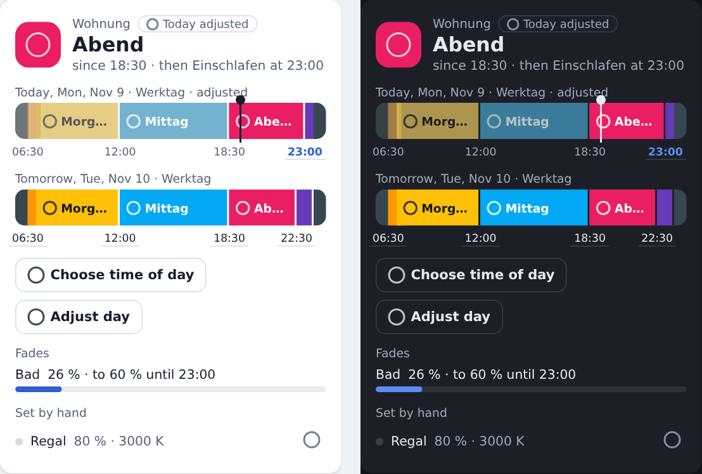
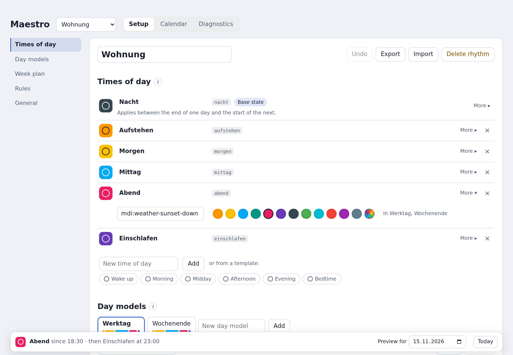
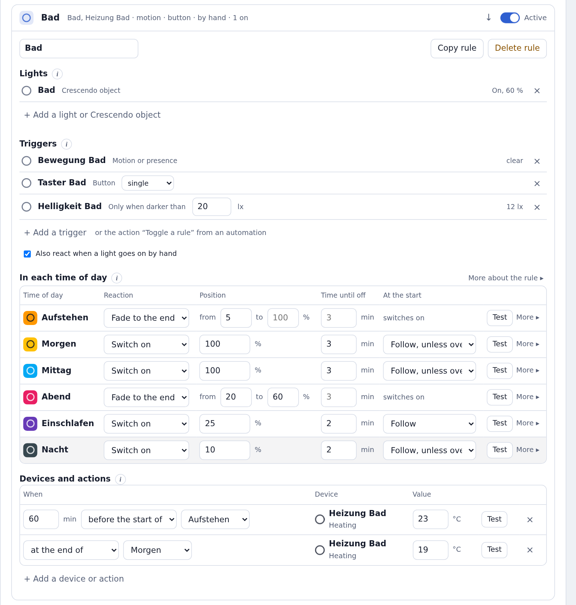

# Cloudless Maestro

A Home Assistant integration that decides which time of day applies right now, and what your lights do in it. Instead of many timed automations there is one daily schedule: freely named times of day, day models such as workday or weekend, a week plan and exceptions for single days. Rules say, per time of day, how motion sensors, buttons and a switch at the wall behave. When your rhythm changes, you change only the schedule.

[Deutsche Version](README.de.md)







> **Beta.** Times of day, rules and the wake-up light are in. Feedback from real homes goes into the next versions.

## What you get

- **Rhythms.** A rhythm is its own daily schedule, for example for the flat, a terrarium or a child's room. Several rhythms run side by side.
- **Your own times of day.** Each has a name, an icon and a color. Its key stays the same when you rename it, so automations keep working.
- **Day models.** Start times fixed or following the sun, with an offset and the bounds *earliest* and *latest*. Times may lie after midnight, for example a party until 06:00.
- **Week plan and calendar.** Every weekday gets a model. A calendar from Home Assistant can override single dates, for example on public holidays, for shift work or on holiday.
- **Rules.** Lights with triggers and one row of values per time of day: how bright, which color, when off again, and what happens to lights that are on when a time of day begins. Motion or presence sensors, buttons and switching on by hand. A light sensor can limit switching on to when it is dark.
- **Memory.** When somebody changes a light by hand, Maestro remembers it: within the memory time the light comes back as set, afterwards with the row again.
- **Wake-up light.** A light, light group or Crescendo object fades up over a whole time of day, for example 30 minutes during “Wake up”.
- **Devices at the right time.** At, before or after the start or the end of a time of day, a blind gets its position, a thermostat its temperature, a speaker its volume; a scene or script starts. For example the bathroom heating 60 minutes before wake-up.
- **Pin and adjust.** Set a time of day now until a chosen end, or give a single date other times, also in advance.
- **For automations.** Every rhythm is a device with sensors, a switch per rule, triggers with an offset, conditions, actions and an event at every change.
- **A card and a settings page**, no YAML needed. English and German. With [Cloudless Crescendo](https://github.com/MadisonMedia/cloudless-crescendo), Maestro drives Crescendo objects through their own actions.

## Install

**Home Assistant 2026.11 or newer (Marketplace)**

[](https://my.home-assistant.io/redirect/hacs_repository/?owner=MadisonMedia&repository=cloudless-maestro&category=integration)

1. Use the button above, or go to **Settings → Marketplace** and add `https://github.com/MadisonMedia/cloudless-maestro` by link. This needs a connection to GitHub, which the Marketplace asks for.
2. While Maestro is in beta, switch on pre-releases for the repository, then install it.

**Home Assistant 2026.10 or older (HACS)**

1. In HACS, open the menu at the top right and choose **Custom repositories**.
2. Add `https://github.com/MadisonMedia/cloudless-maestro` with the type **Integration**.
3. Install **Cloudless Maestro** and restart Home Assistant.

Requires Home Assistant 2026.2 or newer.

## Create your first rhythm

[](https://my.home-assistant.io/redirect/config_flow_start/?domain=cloudless_maestro)

Go to **Settings → Devices & services → Add integration → Cloudless Maestro**, enter a name, choose how to start (a typical day, or a single time of day to build your own) and which colors you like: Home Assistant's own or earth tones. **Maestro** then appears in the sidebar.

## The settings page

Choose the rhythm in the header, or **New rhythm …**. The jump bar on the left leads to the sections; explanations sit behind the small **i** next to a heading.

1. **Times of day:** name, key and, under **More**, icon and color. Add one by name or from a template. A new time of day takes the rule values of the one before it.
2. **Day models:** drag the marks on the timeline, or type the times. **Sun** follows sunrise, sunset or dusk with an offset, and **Bounds** sets earliest and latest. The table shows the result for the preview date, midsummer and midwinter. The bar at the bottom holds the preview date.
3. **Week plan:** a model per weekday, with a small strip showing the day. Below it the calendars.
4. **Rules:** see the next section.
5. **General:** location, the defaults for the rules, examples for automations, and the entry in the sidebar.

**Undo** takes back the last change. **Export** saves the rhythm as a file; **Import** creates a new rhythm from one or replaces the chosen one.

## Rules

A rule has **lights** (Crescendo objects, single lights and light groups), **triggers** and one row per time of day. Lights, triggers and devices are found in a search with kinds as chips and a choice of room; Crescendo objects come first.

| Trigger | What happens |
| --- | --- |
| Motion or presence | Switches on with the row. Once no sensor of the rule sees anybody any more, the time until off runs; every new detection starts it again. Then the light dims to half for a moment as a warning and goes off. Motion during the warning brings it back. |
| Contact | Another binary sensor, such as a door, counts like a motion sensor: open is like motion. |
| Button | An event entity such as a wall remote, with the kind of press. Toggles: off when a light is on, otherwise on with the row. Without motion, the row's time counts from the press. |
| By hand | A light that goes on without Maestro gets the values of the time of day, or its remembered values. A light that goes on *with* a value, such as “light to 80 %”, keeps that value. |
| Only when dark | A light sensor with a threshold. It limits switching on, never switches off. |

Each **row** has a reaction (switch on, fade to the end, only switch off, do nothing), brightness, color, the **time until off**, and what happens **at the start** of the time of day to lights that are on: follow the new row, follow unless overridden, keep, or switch off. Under **More**: transition, memory time, forgetting at the start, a threshold for this row, taking over another row, and using the row for all times of day. **Test** applies a row now.

**Memory.** When somebody changes a light by hand, that light is overridden: it keeps its values and comes back with them when it is switched on again within the memory time. After that, the row applies again. “Follow” at the start of a time of day ends an override; “Follow, unless overridden” leaves such lights alone. The card and the diagnostics list the lights set by hand, with **Forget**.

**Lights in several rules.** The newest command wins. A light another rule switched on counts as switched on by hand for a motion rule, which decides under **More about the rule** whether such lights go off after the same time, after their own time, or not at all. A light switched off by hand stays off; motion is ignored for the lock time, so it does not come back on while you leave the room.

**Wake-up light: fade to the end.** When a row's reaction is “Fade to the end”, the rule's lights come on at the start of that time of day with the brightness **from** and fade until its end to **to**; without a value there, to the next time of day's brightness. White tones go along. Each light gets one command with target and duration and fades by itself; Crescendo objects run the fade with their stops and devices themselves. Fades longer than 1 hour 40 minutes go in parts, and lights without their own fade get small steps. During a fade, motion does not switch off. When somebody changes the light by hand, the fade ends; **Resume** in the card or the action `cloudless_maestro.resume_fade` brings the light to where it would be by now and lets it run on to the end. When the running time of day is pinned, the fade holds and goes on afterwards. When the end moves, it follows. After a restart it goes on from the point it has reached.

**Devices and actions.** Per rule, devices get a value once, at a moment you choose: at, before or after the start or the end of a time of day, with an offset in minutes. Blinds, thermostats, speakers, fans, switches, numbers, and scenes or scripts. An action at the end of a time of day belongs to it, whatever comes next. The diagnostics show the coming actions.

**Crescendo objects** take a position from 1 to 100; the object's buttons serve as presets, and an empty transition means the object's own speed. Maestro keeps the object's switch-on position up to date, so it never flashes with an old value.

Each rule has a **switch** in Home Assistant. Off means paused: the rule switches nothing and follows no change.

## How times are worked out

- A day runs from the start of its first time of day to its day end. In between days the **base state** applies, for example “Night”. There is no fixed change of day at midnight.
- Each time of day lasts until the next one starts. If the next day begins before the previous one ends, the next day wins.
- If a computed start lies before the previous one or after the day end, that time of day does not happen on that date. The settings page shows this in its preview.
- Sun times use the location of Home Assistant or a location per rhythm. If an event does not happen on a date, for example in polar day, the bound you set applies.
- A time after midnight, such as 01:00 at a party, still belongs to the same day: every time has “after midnight” for that.
- All times are local. A time that does not exist when the clocks go forward moves to the next valid minute. A doubled time when they go back counts the first time.
- **Today** is the day that is running. In the base state it is the coming day. At 05:00 before wake-up you can therefore already pin “Wake up”.

## Pin and adjust a day

| End | Meaning |
| --- | --- |
| Until the next change | Until the plan begins a time of day that comes after the chosen one, or the day ends |
| For a duration | 1, 2 or 4 hours or any, at most until the next day begins |
| Until a time | At most until the next day begins |
| Until the next day | Until the first time of day of the next day begins |
| Until reset | No end. The card shows beforehand which change will not happen. |

A new pin replaces the previous one. **Back to plan** ends it. A day adjustment stores only what differs: when you later change the day model, that applies to all other times on that date. Pins, day adjustments and the memory of the lights survive a restart. If the time of day changed during a restart, there is exactly one change.

## In automations

Every rhythm is a device with these entities:

| Entity | State |
| --- | --- |
| Time of day | Key of the current time of day, with name, color, since, until and the next time of day as attributes |
| Choose time of day | A choice pins the time of day until the next change |
| Day model | Key of today's model and where it comes from |
| Next change | When the time of day changes next |
| Progress | How far the current time of day has run, in percent |
| Overridden | On while a time of day is pinned or today is adjusted |
| Rule … | One switch per rule; off pauses it |

In the automation editor the device offers the triggers **A time of day begins** and **A time of day ends**, each with an offset in minutes (negative: before the planned time, for example the heating 15 minutes before wake-up), **The time of day changes**, and the conditions **The time of day is one of** and **The plan is overridden**. At every change, the event `cloudless_maestro_changed` fires with `from`, `to` and the reason.

| Action | Purpose |
| --- | --- |
| `cloudless_maestro.pin` | Pin a time of day, with an end |
| `cloudless_maestro.resume` | Back to the plan |
| `cloudless_maestro.adjust_day` | Adjust a date: another model, other start times, another day end |
| `cloudless_maestro.clear_day` | Remove a day adjustment |
| `cloudless_maestro.toggle_rule` | Switch a rule's lights like a button of the rule would |
| `cloudless_maestro.forget` | Forget what was set by hand |
| `cloudless_maestro.resume_fade` | Resume a fade that was stopped by hand |
| `cloudless_maestro.refresh_calendars` | Read the linked calendars again at once |

```yaml
# A wall switch in an automation toggles the bathroom rule
action: cloudless_maestro.toggle_rule
target:
  entity_id: sensor.home_time_of_day
data:
  rule: bathroom
```

## Diagnostics

The **Diagnostics** tab shows the time of day now, the next change, the rules with their lights and timers, the lights set by hand, and a log of changes and decisions, to answer “Why did the light do that?”. The **light check** switches a light on, fades it and switches it off, and records every answer: how fast, how exactly and how often it reports during a fade. Run it on a light that behaves oddly in a rule.

## The card

Edit a dashboard, add a card and choose **Maestro**. The full variant shows the current time of day, the day as a timeline and, if you like, tomorrow, plus running fades with their progress and the lights set by hand. Tap a coming time to move that change on that date only. The compact variant shows only the time of day and pinning.

## Development

```bash
pip install -r requirements_test.txt
pytest -q
ruff check .
```

`tests/frontend/harness.html` runs the real card and settings page against a simulated Home Assistant, with data from the real backend. Serve the repository's root with any local web server and open this file. `MAESTRO_WRITE_HARNESS=1 pytest tests/test_harness_data.py` refreshes the data, with `MAESTRO_HARNESS_LANG=en` for English.

## License

MIT
