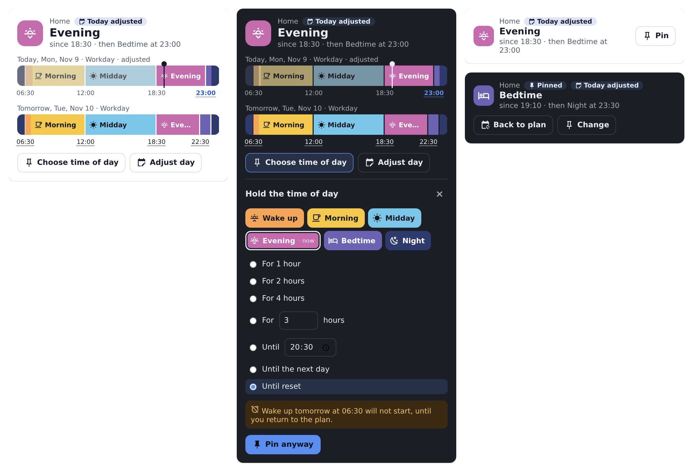
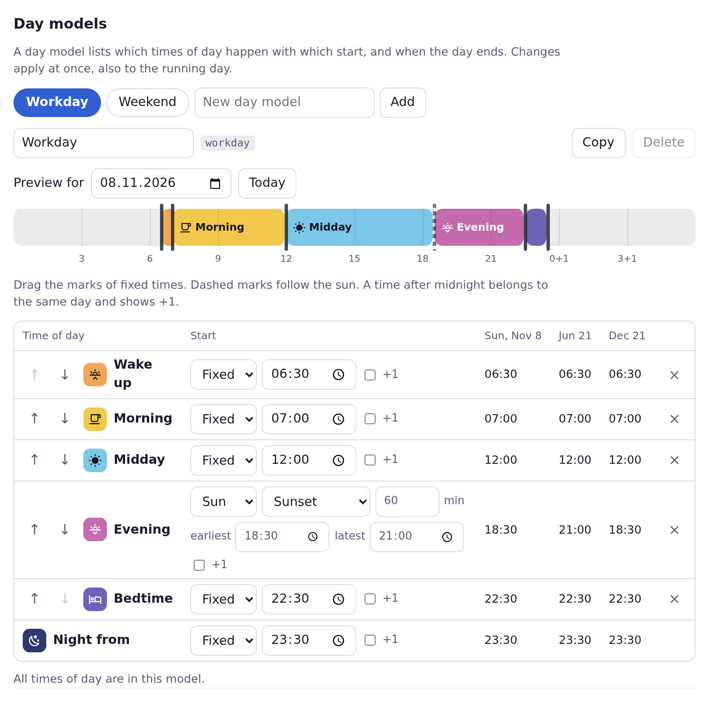

# Cloudless Maestro

A Home Assistant integration that decides which time of day applies right now. Instead of many timed automations there is one daily schedule: freely named times of day, day models such as workday or weekend, a week plan and exceptions for single days. When your rhythm changes, you change only the schedule.

[Deutsche Version](README.de.md)





> **Beta.** This version contains the first part of Maestro, the times of day. Light rules with motion sensors, memory for manual settings and fades such as a wake-up light follow in the next versions.

## What you get

- **Rhythms.** A rhythm is its own daily schedule, for example for the flat, a terrarium or a child's room. Several rhythms run side by side.
- **Your own times of day.** Each has a name, an icon and a color. Its key stays the same when you rename it, so automations keep working.
- **Day models.** Start times fixed or following the sun, with an offset and the bounds *earliest* and *latest*. Times may lie after midnight, for example a party until 06:00.
- **Week plan and calendar.** Every weekday gets a model. A calendar from Home Assistant can override single dates, for example on public holidays, for shift work or on holiday.
- **Pin.** Set a time of day now, earlier or later in the day, until the next change, for a duration, until a time, until the next day or until you reset it. A duration or a time ends when the next day begins at the latest, so your wake-up is never skipped unnoticed.
- **Adjust a day.** Another model or other times for a single date, also in advance: “bedtime at 23:30 tonight”.
- **For automations.** Every rhythm is a device with sensors, triggers, conditions, actions and an event at every change.
- **A card and a settings page**, no YAML needed. English and German.

## Install

**Home Assistant 2026.11 or newer (Marketplace)**

[](https://my.home-assistant.io/redirect/hacs_repository/?owner=MadisonMedia&repository=cloudless-maestro&category=integration)

1. Use the button above, or go to **Settings → Marketplace** and add `https://github.com/MadisonMedia/cloudless-maestro` by link. This needs a connection to GitHub, which the Marketplace asks for.
2. While Maestro is in beta, switch on pre-releases for the repository, then install it.

**Home Assistant 2026.10 or older (HACS)**

1. In HACS, open the menu at the top right and choose **Custom repositories**.
2. Add `https://github.com/MadisonMedia/cloudless-maestro` with the type **Integration**.
3. Install **Cloudless Maestro** and restart Home Assistant.

Requires Home Assistant 2026.2 or newer.

## Create your first rhythm

[](https://my.home-assistant.io/redirect/config_flow_start/?domain=cloudless_maestro)

Go to **Settings → Devices & services → Add integration → Cloudless Maestro**, enter a name and choose how to start: a typical day with wake up, morning, midday, afternoon, evening and bedtime, or a single time of day to build your own. **Maestro** then appears in the sidebar. Set everything up there and add more rhythms.

## How times are worked out

- A day runs from the start of its first time of day to its day end. In between days the **base state** applies, for example “Night”. There is no fixed change of day at midnight.
- Each time of day lasts until the next one starts. If the next day begins before the previous one ends, the next day wins.
- If a computed start lies before the previous one or after the day end, that time of day does not happen on that date. The settings page shows this in its preview.
- Sun times use the location of Home Assistant or a location per rhythm. If an event does not happen on a date, for example in polar day, the bound you set applies.
- All times are local. A time that does not exist when the clocks go forward moves to the next valid minute. A doubled time when they go back counts the first time.
- **Today** is the day that is running. In the base state it is the coming day. At 05:00 before wake-up you can therefore already pin “Wake up”.

## Pin and adjust a day

| End | Meaning |
| --- | --- |
| Until the next change | Until the plan begins a time of day that comes after the chosen one, or the day ends |
| For a duration | 1, 2 or 4 hours or any, at most until the next day begins |
| Until a time | At most until the next day begins |
| Until the next day | Until the first time of day of the next day begins |
| Until reset | No end. The card shows beforehand which change will not happen. |

A new pin replaces the previous one. **Back to plan** ends it. A day adjustment stores only what differs: when you later change the day model, that applies to all other times on that date. Pins and day adjustments survive a restart. If the time of day changed during a restart, there is exactly one change.

## In automations

Every rhythm is a device with these entities:

| Entity | State |
| --- | --- |
| Time of day | Key of the current time of day, with name, color, since, until and the next time of day as attributes |
| Choose time of day | A choice pins the time of day until the next change |
| Day model | Key of today's model and where it comes from |
| Next change | When the time of day changes next |
| Progress | How far the current time of day has run, in percent |
| Overridden | On while a time of day is pinned or today is adjusted |

In the automation editor the device offers the triggers **A time of day begins**, **A time of day ends** and **The time of day changes**, and the conditions **The time of day is one of** and **The plan is overridden**. At every change, the event `cloudless_maestro_changed` fires with `from`, `to` and the reason.

| Action | Purpose |
| --- | --- |
| `cloudless_maestro.pin` | Pin a time of day, with an end |
| `cloudless_maestro.resume` | Back to the plan |
| `cloudless_maestro.adjust_day` | Adjust a date: another model, other start times, another day end |
| `cloudless_maestro.clear_day` | Remove a day adjustment |
| `cloudless_maestro.refresh_calendars` | Read the linked calendars again at once |

```yaml
# Bedtime later tonight
action: cloudless_maestro.adjust_day
target:
  entity_id: sensor.home_time_of_day
data:
  times:
    bedtime: "23:30"
  end: "00:30+1"
```

## The card

Edit a dashboard, add a card and choose **Maestro**. The full variant shows the current time of day, the day as a timeline and, if you like, tomorrow. Tap a coming time to move that change on that date only. The compact variant shows only the time of day and pinning.

## Development

```bash
pip install -r requirements_test.txt
pytest -q
ruff check .
```

`tests/frontend/harness.html` runs the real card and settings page against a simulated Home Assistant, with data from the real backend. Serve the repository's root with any local web server and open this file. `MAESTRO_WRITE_HARNESS=1 pytest tests/test_harness_data.py` refreshes the data.

## License

MIT
